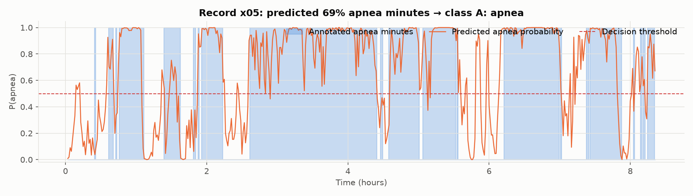
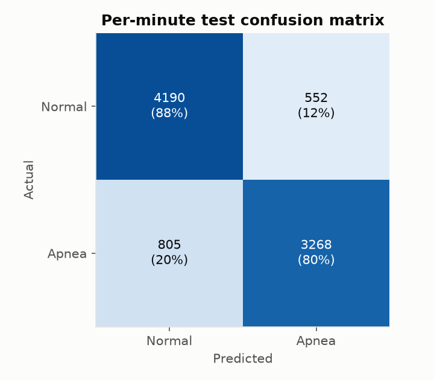
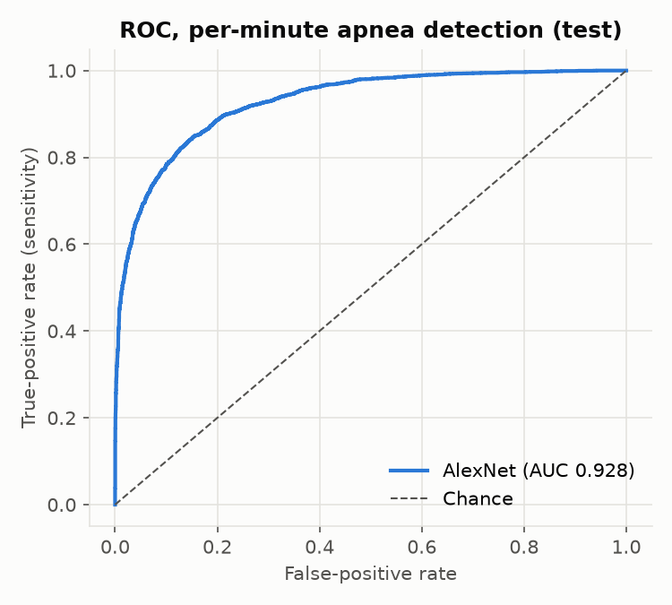
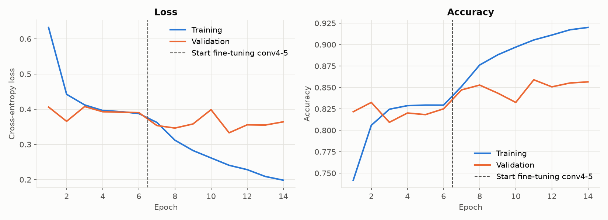
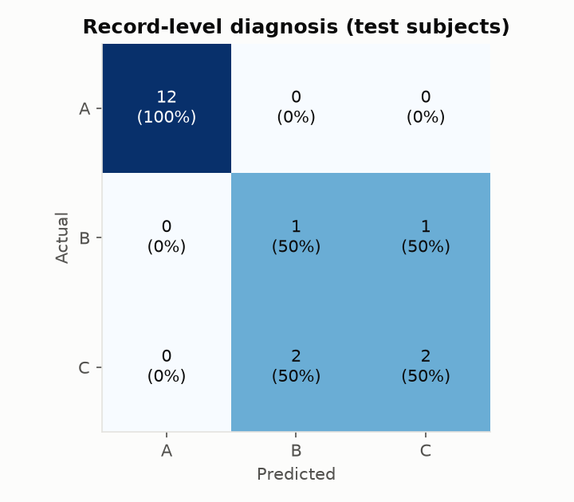
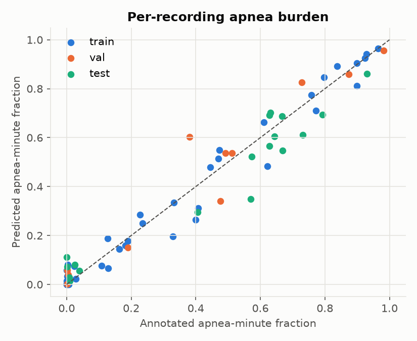
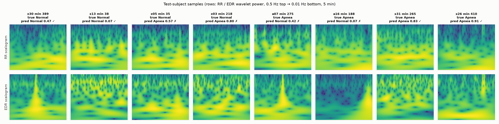

# ECG-Based Sleep-Apnea Detection with AlexNet Transfer Learning

A deep-learning pipeline that detects **obstructive sleep apnea, a sleep-related breathing disorder, from a single-lead ECG**. Each minute of an overnight recording becomes a time-frequency image built from two ECG-derived signals: heart-rate variability and ECG-derived respiration. An **ImageNet-pretrained AlexNet** classifies those images, and the per-minute predictions are aggregated into a recording-level diagnosis (apnea / borderline / control). Evaluation is **subject-independent**: no person appears in both training and testing.

`Python` · `TensorFlow 2.21 / Keras 3` · `AlexNet` · `Transfer learning` · `PyTorch (weight export)` · `wfdb` · `PyWavelets` · `OpenCV` · `scikit-learn`

> ⚠️ Research and portfolio code. **Not a medical device and not clinically validated.**



---

## Relation to the resume wording
The resume lists this project as *"Lung Disease Detection System Using ECG Dataset and Transfer Learning"* (multi-class, 91 % accuracy). The original files were lost. While rebuilding it, I checked the public ECG datasets:

| Candidate | Finding |
|---|---|
| PTB-XL, PTB Diagnostic ECG, MIT-BIH, Chapman-Shaoxing | Labels are **cardiac** (MI, arrhythmia, conduction disease). No lung-disease labels. |
| ECG image sets with a COVID-19 class (Mendeley) | One respiratory class among cardiac classes. Scanned printouts, no patient IDs, so no subject-level split and a high leakage risk. |
| **PhysioNet Apnea-ECG** ✅ | Raw ECG signals, expert labels of a **breathing** disorder for every minute, open licence (ODC-By), and demographic data that allows a subject-level split. |

No public ECG dataset carries genuine multi-class **lung-disease** labels, and relabelling cardiac conditions as lung diseases would be scientifically wrong. So this repository implements the closest defensible task: **detecting a respiratory (breathing) disorder from ECG**. Apnea is not a disease of the lung tissue.

How this compares with the resume:
- Multi-class output is provided at the **recording level**, using the three PhysioNet/CinC classes A / B / C.
- The per-minute task is binary.
- The measured accuracy is **84.6 %** (subject-independent), not 91 %.

## 1. Problem statement
Obstructive sleep apnea affects up to ~1 billion people and is widely underdiagnosed. Diagnosis needs overnight polysomnography in a sleep lab. A single-lead ECG is cheap and wearable-friendly. The question is whether a model can recognise apnea from the ECG alone, on **people it has never seen**.

## 2. Objectives
1. Choose a legitimate dataset whose labels actually support the task, and document its clinical meaning.
2. Turn raw ECG into a representation an ImageNet CNN can use, and justify that choice physiologically.
3. Transfer **AlexNet** ImageNet weights and fine-tune them.
4. Evaluate without leakage (subject-level split) using accuracy, precision, recall, F1, ROC-AUC and confusion matrices, plus a recording-level diagnosis.

## 3. Dataset: PhysioNet Apnea-ECG v1.0.0
70 overnight recordings (100 Hz, 7–10 h each) with an expert **apnea / normal label for every minute**, derived from respiration and SpO₂ signals. Licence: ODC-By. Source, citation and clinical notes are in [data/README.md](data/README.md).

| | Value |
|---|---|
| Labelled minutes | 34,313 |
| Minute images kept | **33,853** (98.7 %; skipped minutes lack ±2 min context or have < 50 % clean beats) |
| Apnea minutes | 38.3 % |
| Pseudo-subjects | **32**, from recordings grouped by identical age/sex/height/weight. This matches the 32 subjects reported for the database. |
| Split (by subject, stratified by recording class) | train 19 subjects / 41 recordings / 19,699 min · val 6 / 11 / 5,339 · **test 7 / 18 / 8,815** |

## 4. Methodology

### 4.1 Signal processing (`src/data/features.py`)
```
ECG (100 Hz) ─► QRS annotations (database) ─► R-peak refinement (±50 ms)
             ─► RR intervals (0.3–2.0 s, ectopic beats > 30 % from local median removed)
             ─► R-wave amplitude = ECG-derived respiration (EDR)
             ─► 5-min window centred on the labelled minute, both series interpolated at 4 Hz
             ─► complex Morlet CWT (64 log-spaced frequencies, 0.01–0.5 Hz)
             ─► 3-channel image (64 × 128):
                  ch0  log RR-scalogram power     (cyclic heart-rate variation of apnea, ~0.01–0.05 Hz)
                  ch1  log EDR-scalogram power    (breathing, ~0.15–0.4 Hz)
                  ch2  cos(phase difference)      (cardio-respiratory coupling)
```
**Why images?** AlexNet is a 2-D image network. Apnea appears in the ECG as slow *modulations* (heart-rate oscillation and breathing-related amplitude changes), not in the waveform shape. Wavelet scalograms make those modulations visible as time-frequency patterns, and mapping the three channels to RGB uses AlexNet's 3-channel input naturally.

### 4.2 AlexNet transfer learning (`src/models/alexnet.py`)
- A Keras AlexNet that is layer-for-layer identical to torchvision's.
- ImageNet weights are exported from `torchvision.models.alexnet(IMAGENET1K_V1)` by `scripts/export_alexnet_weights.py`. The script verifies that the Keras conv stack reproduces torchvision's conv5 outputs (max difference 0.0).
```
image 64×128×3 → per-channel scaling (train-set percentiles) → resize 224×224 → ImageNet normalisation
→ AlexNet conv1–conv5 (pretrained) → flatten 9216 → Dropout(0.5) → Dense(256, ReLU) → Dropout(0.5) → Dense(2, softmax)
```
The 4096-unit FC layers were replaced by a small head (fewer parameters for ~20k training images; the model file is 18.5 MB).

### 4.3 Training (`src/training/train.py`)
| Stage | Trainable | LR | Epochs | Best val loss |
|---|---|---|---|---|
| 1 | head only (backbone frozen) | 1e-3 | 6 | 0.366 |
| 2 | + conv4, conv5 | 3e-5 | 8 | **0.333** (kept) |

Adam, balanced class weights, random time-shift augmentation (±19 s), early stopping with best-weight restore. Stage 2 is kept only if it beats stage 1 on validation. Training on a laptop CPU took 51 min.

### 4.4 Recording-level diagnosis
The predicted apnea-minute fraction is mapped to the PhysioNet/CinC 2000 classes: **A** apnea (≥ 100 apnea min), **B** borderline (5–99), **C** control (< 5). The two cut-points (6.5 % and 17.8 %) are fitted on **training** recordings only.

## 5. Results (held-out subjects, actual measurements)

### 5.1 Per-minute apnea detection
| Split | Accuracy | Macro-F1 | Sensitivity (apnea recall) | Specificity | Apnea precision | ROC-AUC | Minutes |
|---|---|---|---|---|---|---|---|
| Train | 0.930 | 0.921 | 0.893 | 0.949 | 0.898 | 0.980 | 19,699 |
| Validation | 0.859 | 0.857 | 0.864 | 0.855 | 0.816 | 0.940 | 5,339 |
| **Test (7 unseen subjects)** | **0.846** | **0.844** | 0.802 | 0.884 | 0.856 | **0.928** | 8,815 |

Classification report (test):
```
              precision    recall  f1-score   support
      Normal     0.8388    0.8836    0.8606      4742
       Apnea     0.8555    0.8024    0.8281      4073
    accuracy                         0.8461      8815
```
<p float="left">


</p>



### 5.2 Recording-level diagnosis (18 test recordings)
- **15 / 18 correct (83.3 %).** The 3 errors are borderline/control confusions: b01 (B→C), x06 and x24 (C→B).
- Predicted vs annotated apnea burden: **Pearson r = 0.967**.
- Per-recording details are in [results/metrics/per_record_results.csv](results/metrics/per_record_results.csv).

<p float="left">


</p>

### 5.3 Sample predictions


### 5.4 Comparison with the resume
| Resume | This re-implementation |
|---|---|
| "Lung disease", multi-class, ECG-derived signals, AlexNet, 91 % | Sleep apnea (a breathing disorder) from ECG-derived RR/EDR signals, AlexNet transfer learning. **84.6 %** per-minute (binary) and **83.3 %** recording-level (3-class), on **unseen subjects** |

Published subject-independent per-minute results on this database are typically ~84–90 %. Higher numbers in the literature often come from per-minute random splits, which leak a person's data into the test set. This project deliberately avoids that.

## 6. Installation (Windows, VS Code)
```powershell
git clone https://github.com/Harishbala123/ecg-transfer-learning-classification.git
cd ecg-transfer-learning-classification
py -3.11 -m venv .venv
.\.venv\Scripts\Activate.ps1
pip install -r requirements.txt
pip install torch torchvision --index-url https://download.pytorch.org/whl/cpu   # only for the weight export
```
> **Windows path-length note:** TensorFlow's wheel has very deep paths. If `pip install tensorflow` fails with *"No such file or directory … Long Path support"*, either enable Windows long paths (admin) or create the venv in a shorter folder (e.g. `C:\venvs\ecg`). The author's machine used `resume_projects\.venvs\ecg`.

In VS Code: *Python: Select Interpreter* → the venv, then use the integrated terminal.

## 7. Execution
```powershell
python scripts/download_data.py           # Apnea-ECG (~420 MB, SHA-256 verified)
python scripts/export_alexnet_weights.py  # torchvision ImageNet AlexNet → Keras (.npz), with equivalence check
python scripts/build_dataset.py           # ECG → 33,853 minute images (~18 min on 4 CPU workers)
python scripts/train.py                   # two-stage transfer learning (~50 min CPU, a few min on a Colab T4)
python scripts/evaluate.py                # metrics, confusion matrices, ROC, per-record results
python scripts/predict_record.py --record x05   # demo: whole-night prediction for one recording
python -m pytest -q                       # 7 unit tests
```
**Google Colab (GPU):** [notebooks/colab_training.ipynb](notebooks/colab_training.ipynb) ([Open in Colab](https://colab.research.google.com/github/Harishbala123/ecg-transfer-learning-classification/blob/main/notebooks/colab_training.ipynb)) runs the same scripts end to end and exports the model and results as a zip. Native-Windows TensorFlow ≥ 2.11 is CPU-only, so Colab is the recommended place for GPU training.

## 8. Folder structure
```
ecg-transfer-learning-classification/
├── configs/config.yaml
├── data/README.md                 # dataset, licence, clinical scope (raw/processed data not committed)
├── models/                        # alexnet_apnea.keras (+ README)
├── notebooks/colab_training.ipynb
├── results/{graphs,metrics,reports}
├── scripts/                       # download_data, export_alexnet_weights, build_dataset, train, evaluate, predict_record
├── src/
│   ├── data/        download.py, apnea.py (records, labels, subjects, split), features.py (RR/EDR/CWT), dataset.py
│   ├── models/      alexnet.py
│   ├── training/    train.py
│   ├── evaluation/  evaluate.py
│   └── utils/       common.py, plotting.py, export.py
└── tests/test_ecg.py
```

## 9. Limitations
- **Not a lung-disease classifier.** Apnea is a sleep-related breathing disorder; see "Relation to the resume wording" above.
- **Small cohort:** 32 subjects (mostly male, from one centre in 2000). The test set has only 7 subjects / 18 recordings, so the metrics have wide confidence intervals.
- Pseudo-subject IDs are inferred from demographics (no official IDs exist).
- QRS positions come from the database's automatic annotations; a deployed system would need its own QRS detector.
- Single seed. No calibration or external validation. **Not for clinical use.**

## 10. Future improvements
- Leave-one-subject-out cross-validation for tighter estimates.
- External validation (e.g. UCD St. Vincent's or SHHS ECG with apnea labels).
- Compare with lighter backbones (MobileNet / EfficientNet) and with 1-D CNNs on raw RR/EDR.
- Estimate AHI directly (regression) and calibrate probabilities.

## 11. References
1. T. Penzel, G. B. Moody, R. G. Mark, A. L. Goldberger, J. H. Peter. *The Apnea-ECG Database.* Computers in Cardiology 27:255–258, 2000.
2. A. L. Goldberger et al. *PhysioBank, PhysioToolkit, and PhysioNet.* Circulation 101(23):e215–e220, 2000.
3. A. Krizhevsky, I. Sutskever, G. Hinton. *ImageNet Classification with Deep Convolutional Neural Networks.* NeurIPS 2012. A. Krizhevsky. *One weird trick for parallelizing CNNs.* arXiv:1404.5997, 2014.
4. S. K. Singh, S. Majumder. *A novel approach OSA detection using single-lead ECG scalogram based on deep neural network.* J. Mech. Med. Biol. 19(4), 2019.
5. C. Varon et al. *A novel algorithm for the automatic detection of sleep apnea from single-lead ECG.* IEEE TBME 62(9), 2015.
6. G. B. Moody et al. *Derivation of respiratory signals from multi-lead ECGs.* Computers in Cardiology 12:113–116, 1985.

## License
Code: MIT (see [LICENSE](LICENSE)). Data: Apnea-ECG, ODC-By 1.0 (downloaded by script, not redistributed). Pretrained ImageNet weights are downloaded via torchvision and not redistributed.
